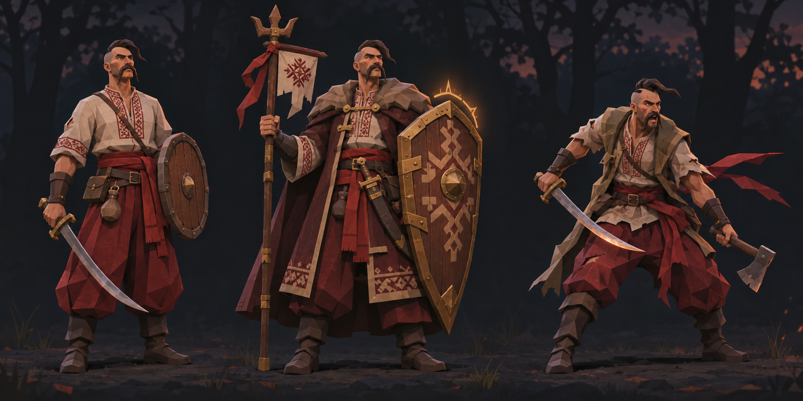
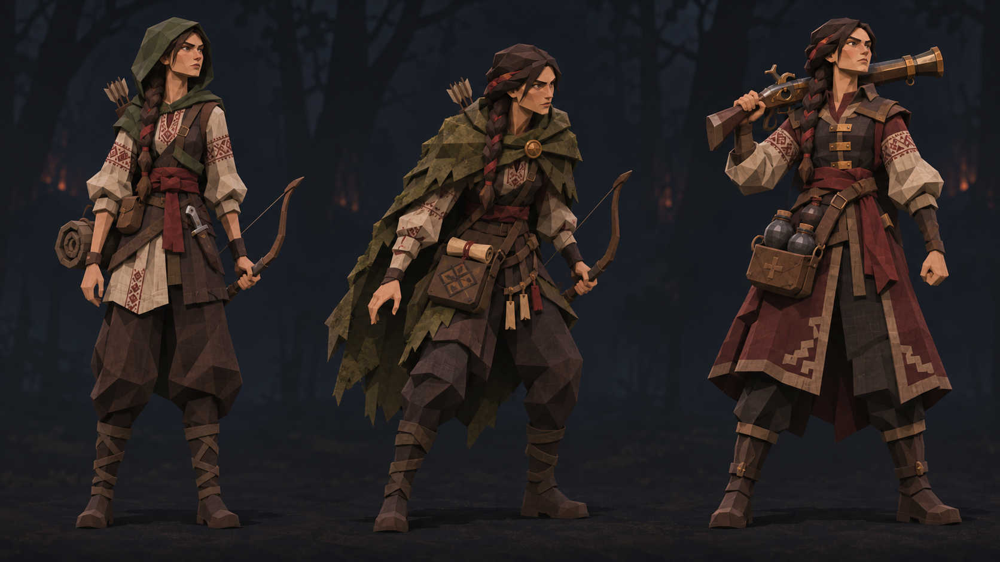
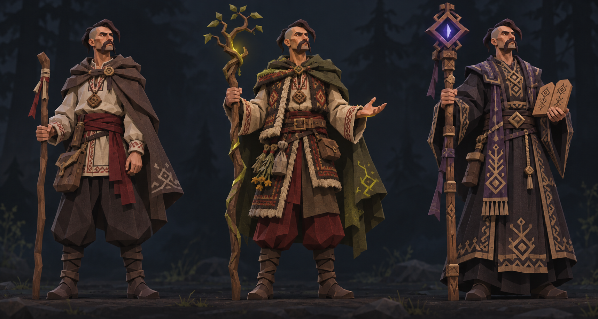

[Game documentation](../README.md) › Classes and ascendancies

# Classes and ascendancies

7 November 2026. These are the selected names and visual directions for the three playable classes and their two paths each. The lineage illustrations are concept references for silhouettes, clothing, equipment and color. They are not finished game assets or a promise of the pictured weapons and abilities.

| Base class      | Core identity           | First ascendancy                                    | Second ascendancy                               |
| --------------- | ----------------------- | --------------------------------------------------- | ----------------------------------------------- |
| **Ратник**      | Frontline fighter       | **Курінний отаман** — protector and party commander | **Гайдамака** — aggressive melee fighter        |
| **Пластун**     | Mobile scout            | **Слідопит** — tracker and precise archer           | **Гармаш** — heavy ranged damage and explosives |
| **Характерник** | Folk-magic practitioner | **Мольфар** — nature wards and support              | **Волхв** — ancient ritual magic                |

The base classes already exist in the game. These six ascendancies are **design targets, not implemented selections**. This document fixes their names, combat identities and art direction. Unlock rules, abilities, balance, equipment restrictions and progression are still to be designed. The existing class IDs, saves and shared passive tree should remain stable until an ascendancy system is specified.

## Shared art rules

- Follow the [approved low-poly direction](../design-guidelines.md): broad faceted shapes, matte materials, dark forest palette, embroidered linen, woven cloth, carved timber and restrained glow.
- Read each path by silhouette and held object before color or ornament. Keep faces, base outfit and proportions related within each three-character sheet so a path feels like an evolution of the same hero.
- Use Ukrainian and Hutsul-inspired embroidery in selective bands, sashes, cloak edges and carved objects. The motifs are visual inspiration, not a claim that the fantasy symbols are historically attested runes.
- Keep all nine figures legible at character-selection size. Reserve saturated color and supernatural light for a path's defining action, not a permanent aura.
- A class and its paths may be represented by any player-character body or gender. The people in these sheets show the costume language and role, not a restriction on character creation.

## Ратник

**Left: Ратник.** The sturdy base fighter. A sabre, practical shield, embroidered linen and oxblood sash establish an adaptable frontline character without already committing to either path.

**Middle: Курінний отаман.** The tank and party-support path, closer in function to a paladin or protective commander. A larger carved shield and short banner make the defensive role visible. Its planned gameplay emphasis is intercepting danger, holding position and strengthening allies. Protective light should be warm and restrained; leadership comes from stance and equipment rather than a crown or heavy Western armor.

**Right: Гайдамака.** The high-risk melee path, closer to a berserker or gladiator in combat rhythm. A lighter, battle-worn outline, sabre and axe distinguish it from the shield bearer. Its planned emphasis is pressure, mobility and escalating damage while exposed. Preserve the Ukrainian rebel identity rather than borrowing Roman arena costume.

## Пластун

**Left: Пластун.** The base scout. A compact bow, knife, light travel gear and subdued hood suggest movement and observation. Keep enough of the embroidered shirt and sash to connect it with the rest of the cast.

**Middle: Слідопит.** The tracking and precision path. A weathered moss cloak, field pouch and ready posture convey patient target selection, route knowledge and controlled shots. Its gameplay should reward finding or exploiting a target's vulnerability more than raw area damage.

**Right: Гармаш.** The heavy ranged and explosive path. The compact early firearm and carried grenades create a wider, weightier silhouette. Its gameplay direction is deliberate burst and area pressure, with an obvious cost in setup, mobility or resources. The pictured gun is a design cue, not an approved item specification; avoid modern military styling.

## Характерник

**Left: Характерник.** The base folk-magic practitioner. A plain travel cloak, staff and carved talisman keep the character grounded in the same world as the fighters. The base form should leave room for either nature-bound or ritual magic.

**Middle: Мольфар.** The nature and support path, drawing on Hutsul mountain atmosphere. Woven wool, herbs and a branch staff distinguish it from a generic fantasy druid. Its planned role is protection, healing or restoration, and interaction with living forces. Use moss and amber effects sparingly.

**Right: Волхв.** The ancient ritual path. A darker robe, carved wooden staff and inscribed tablets set it apart from the organic Мольфар. Its planned role is preparation, wards, curses or powerful ritual effects. The geometric signs are invented for Sichen; avoid presenting them as an authentic historical Slavic script.

## Use in the game

Character selection shows the three base class names. Once ascendancy selection exists, each class should offer its two paths with a concise role cue and a preview of the changed silhouette. Names alone should not carry the choice: a player should be able to tell **protector versus aggressor**, **tracker versus gunner**, and **nature support versus ritual caster** at a glance.

The same visual cues should carry into character, inventory, skill and battle screens through a small path emblem, equipment silhouette and effect colors. Keep the existing minimal HUD; do not add a permanent panel just to explain ascendancy. Put complete descriptions in the deliberate selection/detail view.

For art production notes and the prompts used to make these reference sheets, see [Illustration brief](illustration-brief.md).
