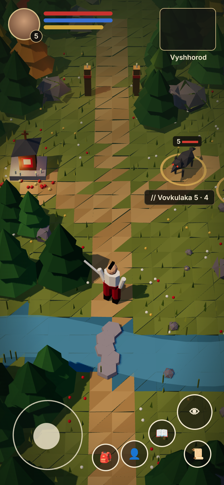

# Wilderness look: proof of concept

30 October 2026. A standalone three.js page that checks how close the approved [wilderness crawler concept](../redesign-concepts/wilderness-crawler.png) can get with the techniques `src/game/render/art-kit.tsx` already uses: primitive geometry, flat-shaded Lambert materials, no downloaded models and no textures.

Open `wilderness.html` in a browser (it loads `three@0.184.0` from unpkg, the version the game uses). The HUD is plain HTML and only marks where the real overlay goes.

## What it uses

| Piece           | Technique                                                                     |
| --------------- | ----------------------------------------------------------------------------- |
| Ground and path | One low-poly plane, colour per face from distance to the path polyline        |
| Rocks           | Icosahedrons with jittered vertices, six shared variants                      |
| Pines           | Three stacked 7-sided cones; a few amber and red autumn trees                 |
| River and ford  | A wavy translucent strip and hexagonal stepping stones                        |
| Shrine and gate | Boxes, a four-sided roof, red cloth planes, candles with one real point light |
| Grass, flowers  | Instanced cones and icosahedrons, one draw call per kind                      |
| Light           | Warm low sun with one shadow map, cool hemisphere fill, fog, CSS vignette     |
| Camera, actors  | Steeper perspective camera; hero and wolves scaled about 1.5×                 |

## Findings

- The environment reaches most of the concept's look with primitives alone. It is the realistic target for the whole world; the painterly town, battle and merchant references are not.
- Primitive characters read as blocky. Free CC0 rigged low-poly models (Quaternius, KayKit, Kenney) match this style; loading textured glTF on native expo-gl is the risk to check first, and untextured, material-coloured models avoid it.
- Rendered in headless Chromium with software GL. Not measured on phones. The game version should instance the trees and rocks and keep real point lights to two or three.
